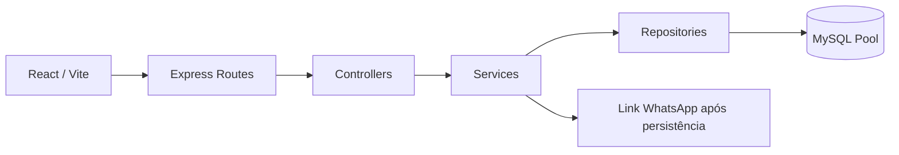

# UniAcademy

Sistema web full stack demonstrativo para uma academia em Recife, Pernambuco. Interface inspirada nas referências fornecidas, com identidade roxa, preta e branca e a logo original. Planos Light (R$ 79,90), Plus (R$ 99,90), MegaPlus (R$ 119,90) e Day-use (R$ 24,90). Valores são propostas, não ofertas comerciais aprovadas.

## Arquitetura

React 19 + Vite + Tailwind CSS 4 + Lucide → API REST Express 5 → Services → Repositories → MySQL 8. Rotas e controllers não acessam SQL. Services concentram regras; repositories usam parâmetros preparados. Injeção de dependências permite testes sem banco. Documentação OpenAPI 3.0 gerada com swagger-jsdoc e servida com swagger-ui-express.



```text
UniAcademy/
├── backend/
│   ├── src/config/          # Ambiente, pool e OpenAPI
│   ├── src/routes/          # URLs e rate limiting
│   ├── src/controllers/     # Contratos HTTP
│   ├── src/services/        # Regras de negócio
│   ├── src/repositories/    # Acesso parametrizado ao MySQL
│   ├── src/middleware/      # Validação e erros
│   ├── src/app.js           # Composição testável
│   ├── src/server.js        # Servidor e encerramento gracioso
│   └── test/                # Integração HTTP com repositório substituído
├── frontend/
│   ├── public/logo.jpg      # Logo fornecida
│   └── src/
│       ├── assets/          # Recursos locais adicionais
│       ├── components/      # layout (Header/Footer) e ui (Brand/SectionTitle)
│       ├── config/          # Navegação centralizada
│       ├── features/home/   # Seções, cartões, dados e hook de catálogo
│       ├── features/trial/  # Modal e hook de envio experimental
│       ├── styles/          # Base, layout, seções, componentes e responsividade
│       ├── pages/Home.jsx   # Apenas composição institucional
│       ├── services/api.js  # Cliente REST
│       ├── styles.css       # Tailwind e identidade visual
│       └── main.jsx
├── database/schema.sql
├── docs/                    # Processos, requisitos, arquitetura e operação
└── .github/workflows/ci.yml
```

## Instalação passo a passo

Pré-requisitos: Node.js 22.12+ ou 24, npm, MySQL Server 8.0+ e opcionalmente MySQL Workbench. Workbench é cliente: o servidor MySQL precisa estar instalado e iniciado.

1. Na raiz, execute `npm install`.
2. No Workbench, abra uma conexão administrativa local, carregue `database/schema.sql` e execute o script inteiro. A reexecução não duplica seeds nem apaga solicitações. Mudanças futuras de schema exigem migrações versionadas.
3. Crie um usuário de aplicação com privilégio mínimo (troque a senha antes de executar):

```sql
CREATE USER IF NOT EXISTS 'uniacademy_app'@'localhost' IDENTIFIED BY 'uma-senha-forte-aqui';
GRANT SELECT ON uniacademy_db.plans TO 'uniacademy_app'@'localhost';
GRANT SELECT ON uniacademy_db.modalities TO 'uniacademy_app'@'localhost';
GRANT SELECT ON uniacademy_db.schedules TO 'uniacademy_app'@'localhost';
GRANT INSERT ON uniacademy_db.trial_requests TO 'uniacademy_app'@'localhost';
```

4. No PowerShell, copie os exemplos:

```powershell
Copy-Item backend/.env.example backend/.env
Copy-Item frontend/.env.example frontend/.env
```

5. Edite `backend/.env`: informe credenciais do MySQL e `WHATSAPP_NUMBER` oficial, por exemplo no formato `5581` + número de nove dígitos. Nenhum número real é presumido. Sem essa configuração, o POST retorna 503 e não grava dados.
6. Em um terminal na pasta `backend`, execute `npm run dev`. Swagger: http://localhost:3001/api/docs. Contrato: http://localhost:3001/api/openapi.json.
7. Em outro terminal na pasta `frontend`, execute `npm run dev`. Site: http://localhost:5173. O Vite encaminha `/api` ao backend.

Alternativamente, `npm run dev` na raiz inicia os dois processos. Execute o backend a partir da pasta dele para que dotenv carregue seu `.env` (os workspaces fazem isso automaticamente).

## Ambiente

| Variável | Papel |
|---|---|
| NODE_ENV | development, test ou production |
| PORT | Porta API; 3001 por padrão |
| CORS_ORIGINS | Lista exata de origens autorizadas, separadas por vírgula |
| DB_HOST / DB_PORT | Servidor MySQL / 3306 |
| DB_USER / DB_PASSWORD / DB_NAME | Credenciais e uniacademy_db |
| DB_SSL | true exige TLS com certificado confiável; false para ambiente local |
| WHATSAPP_NUMBER | Número oficial brasileiro com país e DDD, somente dígitos |
| VITE_API_URL | /api por padrão; URL pública da API quando hospedada separadamente |

Segredos permanecem no backend. Nunca colocar senha em variáveis VITE_. TLS remoto com CA privada exige configurar a CA no pool antes da operação. Não desabilitar verificação de certificado.

## Contratos e comportamento

| Método e rota | Resultado |
|---|---|
| GET /api/site-data | 200 com planos, modalidades, horários e contato |
| POST /api/trial-request | 201 após INSERT, com id, status pending e whatsapp_url |
| GET /api/health | 200 se MySQL responde; 500 em indisponibilidade |

POST requer `client_name`, `phone` (DDD e número, país opcional), `email`, `preferred_modality` existente e `consent: true`. Payload inválido retorna 400. Origem CORS negada retorna 403; rota ausente 404; limite de 10 tentativas/15 minutos por IP retorna 429. Erros internos retornam mensagem genérica e requestId. Swagger apresenta esquemas e respostas 200/201, 400, 500 e adicionais aplicáveis.

O modal cria uma aba no clique de envio para reduzir bloqueio de popup, persiste via API e a direciona ao wa.me somente após sucesso. Em falha, fecha a aba e mostra o erro. Um link de continuidade também aparece após sucesso. Não há envio automático de mensagem nem reserva confirmada. O usuário ainda confirma o envio no WhatsApp.

## Validação

`npm test` executa testes HTTP: sucesso, validação, modalidade inexistente, contato ausente, proteção de detalhes internos, CORS, JSON inválido, Swagger e rate limiting. `npm run build` compila o frontend. Testes usam repositório substituído; não comprovam conexão real com MySQL. Consulte `docs/VALIDATION.md` para o roteiro com banco e navegador.

## Operação e implantação

`npm run build` gera `frontend/dist`. Sirva-o por HTTPS em servidor estático com fallback para index.html. Execute `npm start -w backend` com ambiente de produção e faça proxy de `/api` para Express. Ajuste CORS ao domínio real. Antes de proxy reverso, configure `trust proxy` para a topologia específica; não habilite confiança irrestrita. O limitador atual é em memória e serve a uma instância; múltiplas instâncias precisam de store compartilhado.

Este projeto não foi publicado pelo Sites: Express com conexão MySQL por TCP requer hospedagem compatível com a stack solicitada. Endereço e redes sociais estão marcados como pendentes, em vez de inventar contatos. Fotos remotas Unsplash são ilustrativas e requerem rede; substituir por fotos licenciadas da unidade antes de lançar. A logo está armazenada localmente e é reutilizada na navegação, hero, mapa, rodapé e favicon.

## Maturidade e fontes

Veja `docs/FRONTEND.md`, `docs/PROCESS.md`, `docs/REQUIREMENTS.md`, `docs/ARCHITECTURE.md`, `docs/OPERATIONS.md` e `docs/VALIDATION.md`. A documentação organiza práticas inspiradas em CMMI e MPS.BR; não demonstra nível formal nem certificação. Avaliação exige processos organizacionais executados e evidências históricas.

Referências consultadas em 10/10/2026: [Express 5 — erros](https://expressjs.com/en/5x/guide/error-handling/), [programa MPS.BR — Softex](https://mpsbr.softex.br/), [Guia geral — Softex](https://softex.br/download/guia-geral-de-software-2021/). Referência comercial: [Smart Fit — plano Smart a partir de R$119,90](https://ajuda.smartfit.com.br/hc/pt-br/articles/360051873731-O-que-%C3%A9-o-plano-Smart). Os valores UniAcademy são uma decisão ilustrativa de posicionamento; não resultado de pesquisa abrangente de preços de Recife.
